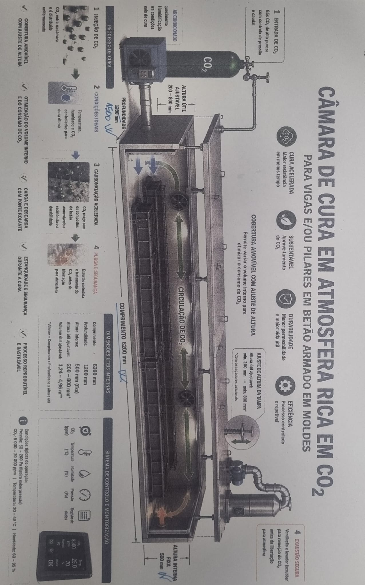

# Protótipo de Câmara de Cura em Atmosfera Rica em CO₂

> **Plano de Desenvolvimento:** Câmara de cura acelerada e controlada para elementos de betão armado (vigas e pilares).

---

## 📸 Referências Visuais do Conceito

| Câmara de Cura / Protótipo | Rampa de Abastecimento ($\text{CO}_2$) | Câmara Climática / Controlo |
| :---: | :---: | :---: |
|  |  |  |
| *Exemplo de câmara estanque sob pressão/vácuo* | *Rampa e garrafas de alimentação de $\text{CO}_2$* | *Unidade de controlo e monitorização* |

---

## 📋 Índice

* [1. Enquadramento e Descrição do Projeto](#1-enquadramento-e-descrição-do-projeto)
* [2. Objetivos](#2-objetivos)
  * [2.1. Objetivo Geral](#21-objetivo-geral)
  * [2.2. Objetivos Específicos](#22-objetivos-específicos)
* [3. Conceção Geral do Protótipo](#3-conceção-geral-do-protótipo)
  * [3.1. Recipiente e Estrutura](#31-recipiente-e-estrutura)
  * [3.2. Tampa e Fecho](#32-tampa-e-fecho)
  * [3.3. Sistema de Vácuo](#33-sistema-de-vácuo)
  * [3.4. Alimentação e Condicionamento de CO₂](#34-alimentação-e-condicionamento-de-co₂)
  * [3.5. Circulação Interna e Purga](#35-circulação-interna-e-purga)
* [4. Instrumentação e Controlo](#4-instrumentação-e-controlo)
* [5. Fluxo de Funcionamento (Ciclo de Cura)](#5-fluxo-de-funcionamento-ciclo-de-cura)
* [6. Cronograma e Plano de Trabalho](#6-cronograma-e-plano-de-trabalho)
* [7. Plano de Ensaios Experimentais](#7-plano-de-ensaios-experimentais)
* [8. Segurança e Requisitos Técnicos](#8-segurança-e-requisitos-técnicos)
* [9. Indicadores de Desempenho (KPIs)](#9-indicadores-de-desempenho-kpis)
* [10. Recursos Necessários](#10-recursos-necessários)
* [11. Resultados Esperados](#11-resultados-esperados)
* [12. Guia: Como Incluir Imagens em Markdown](#12-guia-como-incluir-imagens-em-markdown)

---

## 1. Enquadramento e Descrição do Projeto

O presente projeto tem como finalidade desenvolver um protótipo experimental de uma **câmara de cura em atmosfera rica em dióxido de carbono (**$\text{CO}_2$**)**, destinada à cura acelerada de vigas e/ou pilares de betão armado produzidos em moldes.

A tecnologia cria um ambiente controlado num recipiente fechado, permitindo regular:
* Concentração de $\text{CO}_2$
* Temperatura ($T$)
* Humidade Relativa ($HR$)
* Pressão ($P$)

A utilização de $\text{CO}_2$ visa promover reações de carbonatação no betão, contribuindo para a fixação do gás e alteração favorável da microestrutura (aumento da resistência inicial e redução da permeabilidade). No entanto, o impacto da perda de alcalinidade na proteção contra a corrosão das armaduras será avaliado rigorosamente.

---

## 2. Objetivos

### 2.1. Objetivo Geral
Projetar, construir e validar um protótipo funcional de uma câmara de cura em atmosfera rica em $\text{CO}_2$, capaz de tratar elementos de betão armado sob condições ambientais controladas e de registar continuamente todos os parâmetros do processo.

### 2.2. Objetivos Específicos
* **Acelerar a Cura:** Obter resistências mecânicas precoces e reduzir os tempos de desmoldagem.
* **Sustentabilidade:** Avaliar e otimizar a quantidade de $\text{CO}_2$ fixada/absorvida pelo betão.
* **Melhorar a Durabilidade:** Investigar reduções na porosidade/permeabilidade.
* **Controlar o Processo:** Executar ciclos de cura programáveis, parametrizáveis e repetíveis.
* **Monitorização Integrada:** Medição contínua de $T$, $HR$, $P$ e $\text{CO}_2$ (interior/exterior).
* **Segurança Aumentada:** Implementar sistemas de purga, deteção ambiental e válvulas de alívio.
* **Escalabilidade Modular:** Projetar soluções adaptáveis a pré-fabricação industrial de maior escala.

---

## 3. Conceção Geral do Protótipo

### 3.1. Recipiente e Estrutura
* Estrutura metálica rígida e estanque dimensionada para ciclos duplos (vácuo parcial e pressão positiva).
* Interior resistente à humidade e agentes de limpeza.
* Volume útil ajustado a vigas/pilares e moldes.
* Pontos de passagem estanques para sensores, tubagens e cabos.

### 3.2. Tampa e Fecho
* Tampa articulada ou amovível com fecho mecânico de segurança.
* Junta de vedação em elastómero compatível com $\text{CO}_2$ e variação de $T/P$.
* Interbloqueio mecânico/eletrónico (impede abertura sob pressão/vácuo ou concentração elevada de gás).

### 3.3. Sistema de Vácuo
* Bomba de vácuo, válvula de isolamento, retenção e transdutor de pressão absoluta.
* Utilizado para remoção parcial do ar interior antes da injeção de $\text{CO}_2$, maximizando a pureza e difusão do gás no betão.

### 3.4. Alimentação e Condicionamento de CO₂
* Garrafa/reservatório com regulador de pressão, válvulas de corte e caudalímetro.
* Módulo térmico em linha (aquecimento/arrefecimento) para controlar a temperatura do gás injetado.

### 3.5. Circulação Interna e Purga
* **Circulação:** Ventiladores internos estanques para garantir a homogeneidade de $T$, $HR$ e $\text{CO}_2$.
* **Purga:** Circuito independente para despressurização e exaustão segura do $\text{CO}_2$ para o exterior do edifício antes da abertura da câmara.

---

## 4. Instrumentação e Controlo

### Matriz de Sensores e Monitorização

| Grandeza | Localização | Função Primária |
| :--- | :--- | :--- |
| **Concentração de** $\text{CO}_2$ | Interior da câmara | Medição da percentagem e consumo de gás |
| **Temperatura (**$T$**)** | Interior, Exterior e Linha de Alimentação | Monitorização térmica das reações e do gás |
| **Humidade Relativa (**$HR$**)** | Interior e Exterior | Controlo do perfil de humidade durante a cura |
| **Pressão Absoluta (**$P$**)** | Interior da câmara | Gestão de patamares de vácuo e pressão de cura |
| **Pressão Atmosférica** | Exterior da câmara | Referência para cálculo de diferenciais |
| **Estado de Válvulas e Tampa** | Estrutura / Linhas de gás | Interbloqueio e segurança do operador |

### Unidade de Automação (PLC / Controlador Industrial)
* Controlo em tempo real via ecrã HMI.
* Execução de perfis automáticos de cura.
* Registo contínuo de dados (exportável para `.csv` / Excel).
* Gestão de alarmes e paragens de emergência.

---

## 5. Fluxo de Funcionamento (Ciclo de Cura)

```
[1. Carregamento e Preparação] 
              │
              ▼
[2. Fecho e Teste de Estanquidade] 
              │
              ▼
[3. Aplicação de Vácuo Parcial] 
              │
              ▼
[4. Condicionamento Térmico] 
              │
              ▼
[5. Injeção Controlada de CO₂] 
              │
              ▼
[6. Fase de Cura Controlada] 
              │
              ▼
[7. Purga e Exaustão Segura] 
              │
              ▼
[8. Despressurização e Abertura]
```

---

## 6. Cronograma e Plano de Trabalho

O projeto está estruturado num plano de **20 semanas**:

```
Semanas 01-02: [Fase 1] Pesquisa e Requisitos
Semanas 03-04: [Fase 2] Projeto Mecânico e CAD
Semanas 05-06: [Fase 3] Circuitos de Gás e Térmico
Semanas 07-08: [Fase 4] Automação, PLC e Sensores
Semanas 09-11: [Fase 5] Fabrico e Montagem
Semanas 12-13: [Fase 6] Comissionamento e Seguranças (sem betão)
Semanas 14-17: [Fase 7] Ensaios Experimentais com Betão
Semanas 18-20: [Fase 8] Tratamento de Dados, Relatório e Validação
```

---

## 7. Plano de Ensaios Experimentais

### Variáveis de Estudo
1. Concentração de $\text{CO}_2$ ($0\%$ a $100\%$)
2. Temperatura de Cura
3. Humidade Relativa
4. Pressão / Nível de Vácuo prévio
5. Duração do Ciclo de Cura
6. Idade/Grau de Hidratação Inicial do Betão
7. Formulação da Mistura de Betão

### Caracterização do Betão
* **Mecânica:** Resistência à compressão e flexão em idades precoces ($1, 3, 7$ dias) e aos $28$ dias.
* **Durabilidade:** Absorção de água, porosidade por intrusão de mercúrio e permeabilidade.
* **Carbonatação:** Profundidade de carbonatação (teste de fenolftaleína) e verificação do risco de corrosão nas armaduras.

---

## 8. Segurança e Requisitos Técnicos

> ⚠️ **Aviso de Segurança:** O dióxido de carbono ($\text{CO}_2$) é incolor, inodoro e asfixiante. A câmara opera com diferenciais de pressão (vácuo e pressão positiva).

* **Dimensionamento Estrutural:** O recipiente deve ser certificado para cargas combinadas de vácuo e pressão por um técnico habilitado.
* **Sensor de** $\text{CO}_2$ **Ambiente:** Instalação obrigatória na sala de trabalho com alarme sonoro/luminoso.
* **Válvulas de Alívio:** Válvula de segurança mecânica e disco de rutura na câmara.
* **Interbloqueio:** Bloqueio mecânico da tampa enquanto $P_{int} \neq P_{atm}$ ou $\% \text{CO}_2 > \text{limite seguro}$.

---

## 9. Indicadores de Desempenho (KPIs)

* **Estabilidade e Controlo:** Desvio $< 5\%$ entre o *setpoint* e os valores medidos ($T, HR, P, \text{CO}_2$).
* **Uniformidade:** Variação espacial mínima dentro da câmara.
* **Eficiência de Cura:** Ganho percentual de resistência inicial vs. cura convencional em câmara húmida.
* **Fixação de** $\text{CO}_2$**:** Quantidade ($\text{kg}$ de $\text{CO}_2$ fixado $/ \text{m}^3$ de betão) calculada por balanço de massa.

---

## 10. Recursos Necessários

* **Equipamento & Hardware:** Recipiente estrutural, bomba de vácuo, cilindros de $\text{CO}_2$, permutador térmico, ventiladores de circulação, PLC, ecrã HMI, sensores industriais.
* **Equipa Multidisciplinar:**
  * Engenharia Mecânica (Projeto de vasos sob pressão)
  * Engenharia Civil / Materiais (Tecnologia do Betão)
  * Automação e Eletrónica
  * Técnico de Segurança no Trabalho

---

## 11. Resultados Esperados

1. Protótipo funcional e validado para cura acelerada por $\text{CO}_2$.
2. Manual de Operação e Segurança.
3. Base de dados experimental detalhada com as curvas otimizadas de cura.
4. Relatório final com análise do impacto na resistência, durabilidade, custos e pegada de carbono.

---

## 12. Guia Visual

```markdown

```